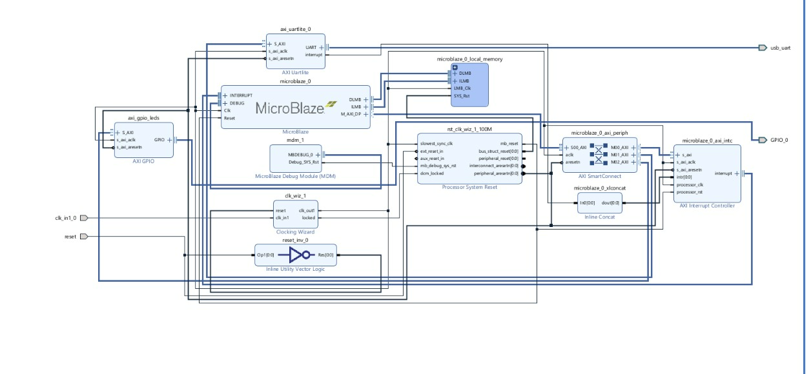
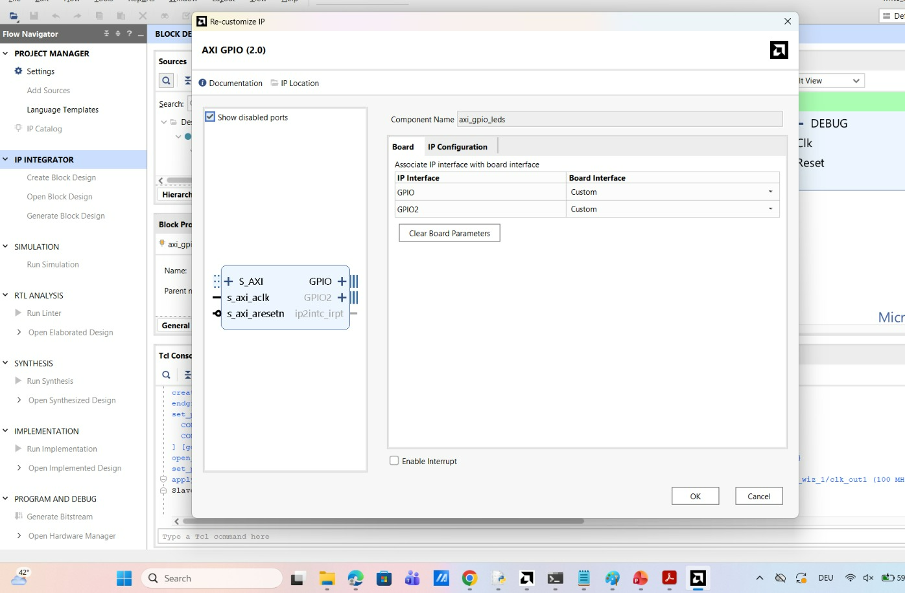
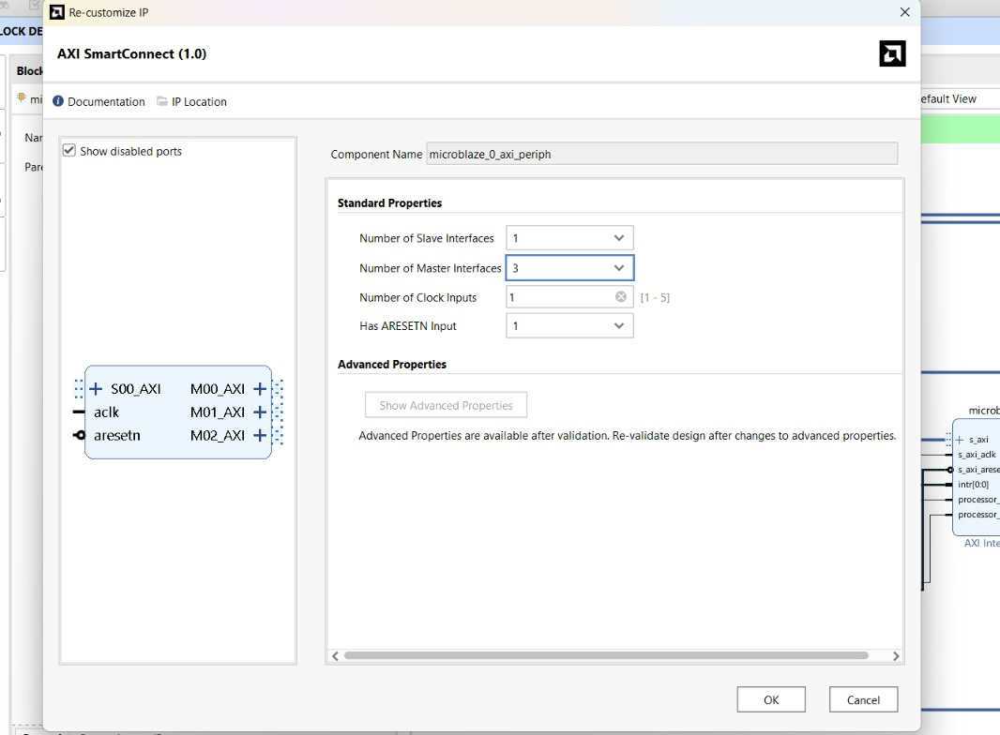
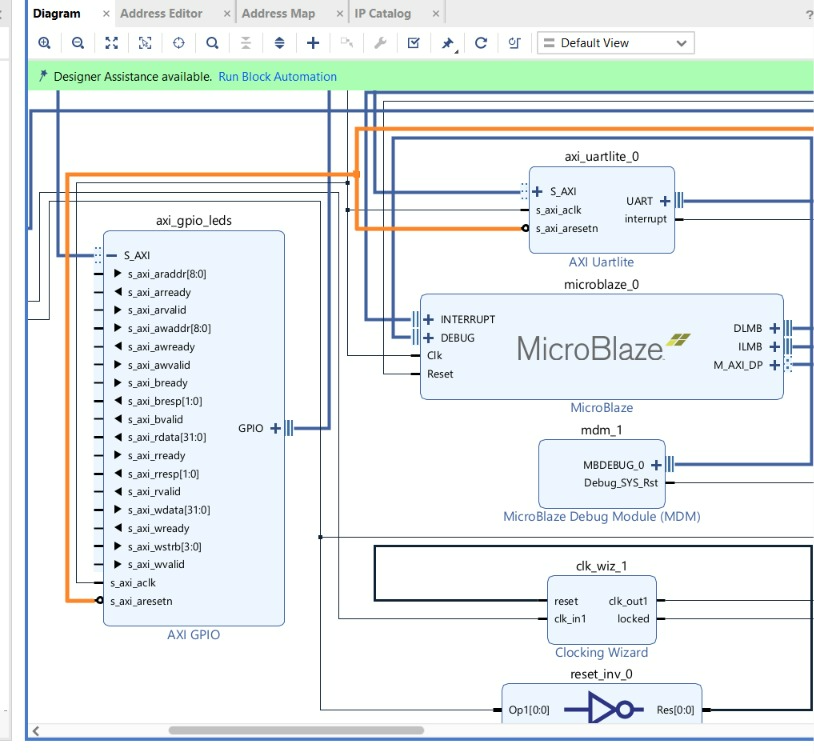
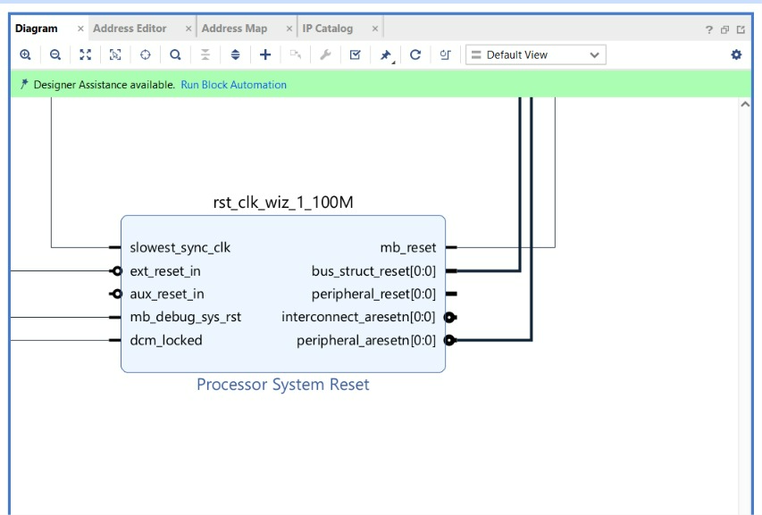
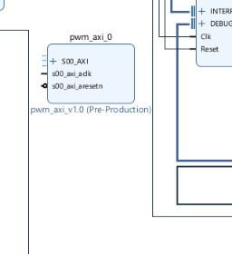
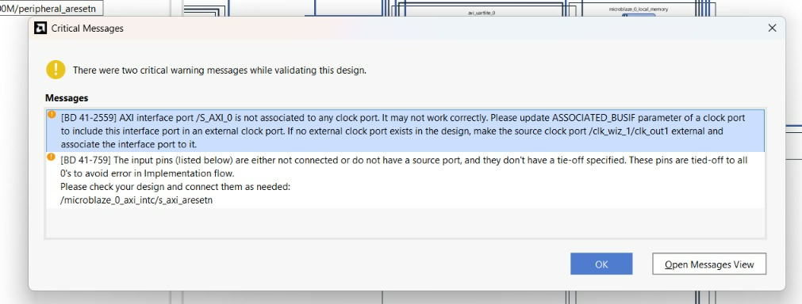
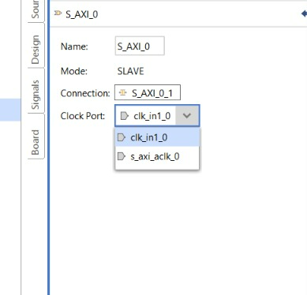

# Advanced Hardware Engineering — Lab 03
## GPIO, 7-Segment Display and Custom PWM IP on MicroBlaze

**University:** Hochschule Hamm-Lippstadt (HSHL)  
**Course:** Advanced Hardware Engineering · WS 2026  
**Instructor:** Prof. Dr.-Ing. Ali Hayek  
**Target:** Digilent Nexys A7-100T (Artix-7)  
**Toolchain:** Vivado 2025.2 / Vitis 2025.2 (reported working environment)  
**Status:** 🚧 **IN PROGRESS — approximately halfway through, informal estimate; not a verified completion percentage**  
**Source of requirements:** `05_AHE_Lab_Microblaze_GPIO_PWM_final.pdf` (31-page supplied lecture PDF; printed slide numbers differ from PDF page numbers)

> **Evidence policy:** “Completed” means visible in an uploaded screenshot or confirmed in an inspected artifact. “In progress” means a partial implementation is visible. “Needs verification” means an apparent step cannot be fully checked from current evidence. Lab 02 artifacts are baseline evidence only, not proof of Lab 03 completion. **No Lab 03 board demo, successful validation, bitstream, or working software is claimed.**

## 1. Lab Overview

Lab 03 extends the Lab 02 MicroBlaze soft-processor system with memory-mapped peripherals. The intended complete system reads 16 slide switches, mirrors their values onto 16 LEDs, multiplexes the 7-segment display, and controls an RGB LED through the custom `pwm_axi` IP developed in Lab 01. The MicroBlaze accesses AXI GPIO and PWM registers from C using `Xil_In32` and `Xil_Out32`.

The supplied screenshots document **hardware assembly and debugging**, particularly the first AXI GPIO, AXI SmartConnect expansion, insertion of the custom PWM IP, and two critical validation warnings. The project has not yet reached an evidenced hardware/software integration test.

## 2. Lab Objectives

- [ ] Demonstrate switch-to-LED mirroring on the Nexys A7.
- [ ] Show a hexadecimal switch value on four rightmost 7-segment digits using software multiplexing.
- [ ] Control RGB LED duty cycles through the custom AXI4-Lite PWM IP.
- [ ] Integrate all three functions in one MicroBlaze C application.
- [ ] Produce a working board demonstration, updated block-design screenshot, commented C source, and utilization comparison with Lab 02.

These are **end-of-lab objectives**, not claims of completed work (PDF pp. 2–3, 17, 28, 31).

## 3. Assignment Requirements

### Task 1 — Extend the hardware (PDF pp. 7–16)

1. Save a **copy** of the working Lab 02 Vivado project; keep the original intact.
2. Register the packaged Lab 01 `pwm_axi` IP repository if necessary.
3. Configure GPIO 0 as dual channel: **16-bit switches, inputs** on channel 1 and **16-bit LEDs, outputs** on channel 2; use board interfaces if available.
4. Add GPIO 1 for the display: **8-bit segment outputs** on channel 1 and **8-bit digit-enable outputs** on channel 2.
5. Add the custom PWM IP and verify its AXI interface and `pwm_r`, `pwm_g`, `pwm_b` outputs.
6. Run connection automation; expose and name the external signals `led`, `sw`, `seg`, `an`, `pwm_r`, `pwm_g`, `pwm_b`.
7. Record actual base addresses for GPIO 0, GPIO 1, and PWM in Address Editor; validate the design with no unresolved critical connection issues.
8. Constrain all pins with the correct Nexys A7 master XDC; preserve Lab 02 clock/reset/UART constraints as applicable.
9. Regenerate wrapper if necessary, generate bitstream, compare utilization with Lab 02, and export a **new Lab 03 XSA including bitstream**.

### Task 2 — Control hardware from C (PDF pp. 17–29)

1. Update/create Vitis platform from **Lab 03 XSA**; build BSP and identify actual addresses in `xparameters.h`.
2. Read switches and write LEDs; test normal, inverted, and LED0-if-any-switch-up variants.
3. Implement the 16-entry active-low segment lookup table and multiplex the rightmost four digits; first test `0x1234`, then display the switch value. The PDF also proposes optional exercises (e.g. `0xABCD`, delay changes, decimal point, eight digits).
4. Enable PWM and test a colour fade by writing the control and duty registers.
5. Combine LED mirroring, hex display, and switch-controlled RGB duty cycles into **one `main.c`**.
6. Program the FPGA with the **new** bitstream, run the ELF on MicroBlaze, and demonstrate response to the switches.

### Additional tasks (PDF p. 30)

The PDF also presents additional exercises: running counter, inverted switch mirroring, blinking an LED, UART reporting, breathing RGB LED, switch-selected colour, UART colour commands, and advanced GPIO interrupts. These are tracked separately as **additional/extension tasks**; the slide does not label them as mandatory core deliverables.

## 4. Tools and Technologies

| Item | Purpose | Evidence |
|---|---|---|
| AMD Vivado 2025.2 | IP Integrator, AXI wiring, constraints, validation, synthesis/implementation | Screenshots 01–09 |
| AMD Vitis 2025.2 | Embedded platform, BSP, C application, hardware launch | Lab 02 conversation only; Lab 03 update pending |
| MicroBlaze / AXI UART Lite / local memory / MDM / reset | Processor system inherited from Lab 02 | Screenshot 02; Lab 02 archive |
| AXI GPIO 2.0 | Two-channel switch/LED and display interface | Screenshot 01; only first instance visible |
| AXI SmartConnect 1.0 | AXI interconnect for multiple peripherals | Screenshot 03 |
| Custom `pwm_axi` | Memory-mapped RGB PWM from Lab 01 | Screenshot 06 (block visible; outputs not shown) |
| Nexys A7-100T | Intended physical test board | Requirement; no Lab 03 board test evidenced |

## 5. Work Completed So Far

### 5.1 Baseline processor system available — **Completed as baseline; Lab 03 copy needs verification**

The overview diagram shows `microblaze_0`, `microblaze_0_local_memory`, `mdm_1`, `axi_uartlite_0`, a clock wizard, reset logic, AXI SmartConnect, interrupt logic, and the UART external port. This confirms that a MicroBlaze-based system is present in the **shown design**. The supplied `AHE_MicroBlaze_Lab02_B7.zip` is an archived Lab 02 project and includes `design_microblaze.bd`, a constraints file, and `design_microblaze_wrapper.xsa`; these establish a baseline, **not a completed Lab 03 build**.


*Figure 1 — Existing MicroBlaze subsystem and an added AXI GPIO in the block diagram. The screenshot does not prove a fully validated Lab 03 system.*

### 5.2 First AXI GPIO inserted — **In progress**

A configuration window identifies the instance as `axi_gpio_leds` (AXI GPIO 2.0). Its **Board** tab lists `GPIO = Custom` and `GPIO2 = Custom`; the screenshot does **not** show the **IP Configuration** tab. Thus, the presence of the block is confirmed, but dual-channel enable, 16-bit widths, input/output directions, and correct Nexys board bindings remain unverified. In the diagram, the GPIO appears connected into the AXI infrastructure, but final I/O mapping is not established.


*Figure 2 — `axi_gpio_leds` configuration dialog; channel parameters require a separate IP Configuration check.*

### 5.3 SmartConnect expanded — **Completed as a configuration action; connectivity needs verification**

The `microblaze_0_axi_periph` SmartConnect configuration shows **1 slave interface**, **3 master interfaces**, **1 clock input**, and **1 ARESETN input**. Three master interfaces provide capacity for multiple AXI peripherals, but this setting by itself does not prove that all expected peripherals are connected and address-mapped.


*Figure 3 — AXI SmartConnect configured with three master interfaces.*

### 5.4 GPIO clock/reset and AXI signal inspection — **In progress**

The expanded GPIO view shows the AXI bus pins, `s_axi_aclk`, `s_axi_aresetn`, and GPIO interface. The clock/reset wiring was inspected. A separate screenshot shows the `rst_clk_wiz_1_100M` processor reset module with `peripheral_aresetn[0:0]`, the active-low reset source normally needed for AXI peripherals. The screenshots alone do not establish that every relevant AXI interface is on the correct clock domain.


*Figure 4 — Expanded AXI GPIO interface with clock and reset wiring under inspection.*


*Figure 5 — Processor System Reset block and its reset outputs.*

### 5.5 Custom PWM IP inserted — **In progress**

The diagram shows an instance named `pwm_axi_0`, identified as `pwm_axi_v1.0 (Pre-Production)`, with `S00_AXI`, `s00_axi_aclk`, and `s00_axi_aresetn` visible. This supports **insertion** of the custom IP into the block design. The provided crop does **not** show the `pwm_r/g/b` output ports or their external connections, and does not verify the register map, AXI address assignment, or hardware function.


*Figure 6 — `pwm_axi_0` appears in the block design; complete connectivity is not shown.*

### 5.6 Design validation attempted — **Completed attempt; validation unresolved**

Vivado reports **two critical warnings**:

```text
[BD 41-2559] AXI interface port /S_AXI_0 is not associated to any clock port.
[BD 41-1759] Input pin /microblaze_0_axi_intc/s_axi_aresetn is not connected
             (or has no source/tie-off).
```

These warnings are **observed results**, not hypothetical issues. The first concerns the clock association of an external AXI slave interface; the second concerns the interrupt controller's active-low AXI reset. Do not treat the design as validated until these are resolved and validation is rerun.


*Figure 7 — Two critical Vivado validation warnings requiring correction.*

### 5.7 Clock-association option investigated — **Needs verification**

Two screenshots show the external `S_AXI_0` interface settings and a **Clock Port** dropdown offering `clk_in1_0` and `s_axi_aclk_0`. The visible selected value is `clk_in1_0`. This proves that clock association was investigated, **not** that the correct clock was selected or that the warning was resolved. The intended clock must match the actual connected AXI clock domain; do not select an option solely to silence validation.


*Figure 8 — External AXI interface properties and available clock association choices.*


*Figure 9 — Follow-up view of the same dropdown; no successful revalidation is shown.*

## 6. Technical Implementation and Explanation

### 6.1 Memory-mapped I/O

The professor's register map defines the **offsets**, not the final instance base addresses. The actual base addresses must be read from Vivado Address Editor / generated `xparameters.h` after the new XSA is built.

| Peripheral | Offset | Meaning |
|---|---:|---|
| GPIO 0 | `0x00` | Channel 1: 16 switch input bits |
| GPIO 0 | `0x08` | Channel 2: 16 LED output bits |
| GPIO 1 | `0x00` | Channel 1: 8 active-low segment outputs |
| GPIO 1 | `0x08` | Channel 2: 8 active-low digit-enable outputs |
| Both GPIOs | `0x04`, `0x0C` | Channel 1 / channel 2 direction registers |
| PWM | `0x00` | `CTRL`, bit 0 enables PWM |
| PWM | `0x04`, `0x08`, `0x0C` | 8-bit red, green, blue duty registers |

**Do not copy the sample base addresses `0x40000000`, `0x40010000`, or `0x44A00000` into the final application without checking Address Editor.** They are examples in the assignment (PDF pp. 19–21, 27).

### 6.2 Planned GPIO and display behavior

The first GPIO's channel 1 will be read with `Xil_In32`; channel 2 will receive the same 16-bit value through `Xil_Out32`. For the display, the assignment uses a 16-entry lookup table of active-low patterns (`0xC0` for `0`, `0xF9` for `1`, etc.). Software will disable all digits, set the segment pattern, enable one digit, wait 1 ms, and repeat across four digits. This is the **specified design**, not an implementation already demonstrated.

### 6.3 Planned PWM behavior

The custom AXI IP exposes `CTRL` and three duty registers. The professor's example enables PWM by writing `1` to `CTRL`, then varies red and green duties inversely while holding blue constant. In the final application, three four-bit switch groups (3:0, 7:4, 11:8) are scaled by **17** to produce 8-bit duty values between 0 and 255 (PDF pp. 27–28). Neither fading nor switch-controlled RGB output has been demonstrated in the supplied evidence.

### 6.4 Validation warning analysis

| Warning | Meaning | Action required | Verified fixed? |
|---|---|---|---|
| `BD 41-2559` | External AXI slave interface has no valid clock association | Check whether `S_AXI_0` should exist; associate it with the clock that actually drives its AXI domain, or remove unintended external AXI exposure | **No** |
| `BD 41-1759` | `microblaze_0_axi_intc/s_axi_aresetn` is unconnected / untied | Connect it to the appropriate `peripheral_aresetn` output in the same AXI clock domain; rerun validation | **No** |

The first warning may indicate that an AXI peripheral was accidentally made external rather than connected to SmartConnect. This is a **diagnostic possibility**, not a confirmed root cause.

## 7. Screenshots and Evidence

All numbered screenshots below are bundled under `docs/images/` with the README. They are **Lab 03 progress evidence**, not professor reference screenshots.

| Image | Observed evidence | Limitation |
|---|---|---|
| [01](docs/images/01-axi-gpio-configuration.png) | `axi_gpio_leds` IP customization | Width/direction not visible |
| [02](docs/images/02-microblaze-block-design.png) | MicroBlaze subsystem and GPIO | Full design not validated |
| [03](docs/images/03-smartconnect-configuration.png) | SmartConnect 1 slave / 3 masters | Actual connections not all proven |
| [04](docs/images/04-gpio-axi-clock-reset.png) | GPIO AXI pins and wiring | Clock-domain correctness unverified |
| [05](docs/images/05-reset-controller.png) | Processor System Reset outputs | Interrupt-controller reset unresolved |
| [06](docs/images/06-pwm-ip-added.png) | Custom `pwm_axi_0` block | RGB outputs not visible |
| [07](docs/images/07-validation-warnings.png) | Two critical warnings | Validation not successful |
| [08](docs/images/08-axi-clock-association.png) | Clock Port dropdown | Correct choice not proven |
| [09](docs/images/09-clock-association-followup.png) | Follow-up clock settings | No revalidation shown |

**Additional uploaded evidence:** Two WhatsApp ZIP archives contain twelve further JPEGs, preserved under `docs/images/archive-1-01.jpg` through `archive-1-07.jpg` and `archive-2-01.jpg` through `archive-2-05.jpg`. They are retained as supplementary source images; their content is **not used to claim additional completed milestones** in this report.

## 8. Requirements vs. Current Progress

Status definitions: **Completed** = directly evidenced; **In Progress** = partially evidenced; **Pending** = no completed evidence; **Needs Verification** = insufficient evidence to decide.

| PDF requirement / checkpoint | Current evidence | Status | Remaining proof or work |
|---|---|---|---|
| 1.1 Copy Lab 02 project | Lab 02 archive; MicroBlaze baseline in Fig. 1 | Needs Verification | Show separate Lab 03 project path / Save As |
| 1.2 Add Lab 01 PWM repository | PWM block visible (Fig. 6) | In Progress | Confirm repository and packaged IP metadata |
| 1.3 GPIO 0 for 16 switches + 16 LEDs | GPIO instance in Figs. 1–2 | In Progress | Verify dual channels, widths, directions, external pins |
| 1.4 GPIO 1 for 7-segment | No clearly identifiable second GPIO | Pending | Add 8+8 output channels |
| 1.5 Insert PWM IP and verify RGB outputs | `pwm_axi_0` in Fig. 6 | In Progress | Verify `pwm_r/g/b` ports and register map |
| 1.6 Connect AXI, clocks, resets; externalize I/O | Partial wiring Figs. 2, 4–6 | In Progress | Finish wiring, rename `led/sw/seg/an/pwm_*` |
| 1.7 Address map | No base addresses visible | Pending | Record 3 actual addresses |
| 1.7 Validate design | Validation warning dialog Fig. 7 | In Progress | Resolve both critical warnings; rerun F6 |
| 1.8 Nexys A7 pin constraints | No Lab 03 XDC shown | Pending | Assign all ports; check board revision |
| 1.9 HDL wrapper / Lab 03 bitstream | Lab 02 archive only | Pending | Update wrapper; synthesize/implement/generate bitstream |
| 1.9 Utilization comparison | No Lab 03 utilization | Pending | Compare Lab 02 vs Lab 03 LUT/FF/BRAM etc. |
| 1.9 New XSA with bitstream | Lab 02 XSA exists | Pending | Export new Lab 03 XSA |
| 2.1 Vitis platform and base addresses | Earlier Lab 02 workflow only | Pending | Import new XSA, build BSP, inspect `xparameters.h` |
| 2.2 Switch-to-LED C test | No Lab 03 C or board result | Pending | Build/run and test variants |
| 2.3–2.4c 7-segment patterns/multiplexing | PDF code only | Pending | Implement and test fixed `0x1234`, then switches |
| 2.4d Display main loop / directions | PDF code only | Pending | Configure directions as required and run |
| 2.5 PWM fade | PWM block present; no C test | Pending | Enable and test RGB fade |
| 2.6 Combined application | No combined C source | Pending | Integrate all three outputs in one `main.c` |
| 2.7 Board programming/demo | No Lab 03 board evidence | Pending | Program latest bitstream, run ELF, record demo |
| Deliverable: block design screenshot | Partial block diagram Fig. 1 | In Progress | Capture final fully connected diagram |
| Deliverable: utilization vs Lab 02 | None for Lab 03 | Pending | Export implementation reports |
| Deliverable: commented C source | None for Lab 03 | Pending | Commit commented `main.c` |
| Deliverable: working demo | None | Pending | Capture board test video/photos |
| Additional exercises (p. 30) | No evidence | Pending (extension) | Attempt only if assigned/time permits |

## 9. Pending Tasks and Remaining Work

**Priority order follows dependencies.**

1. **Correct hardware wiring and validation.** Fix the external `S_AXI_0` clock association or unintended external AXI interface, and connect the AXI interrupt controller reset. **Outcome:** no unresolved critical block-design validation warnings. **Depends on:** current block diagram.
2. **Verify GPIO 0 and add GPIO 1.** Set switches as 16 inputs and LEDs as 16 outputs; configure the display's segments and digit enables as two 8-bit output channels. **Outcome:** two correctly configured GPIO IPs. **Depends on:** completed AXI clock/reset architecture.
3. **Complete PWM and all external ports.** Verify the PWM AXI slave, RGB output ports, AXI SmartConnect wiring, and external names. **Outcome:** all expected peripherals and external pins present. **Depends on:** steps 1–2.
4. **Assign memory addresses and validate.** Record the three actual base addresses in Address Editor. **Outcome:** valid memory map ready for Vitis. **Depends on:** connected AXI peripherals.
5. **Finish the XDC constraints.** Apply the Digilent master XDC for the exact Nexys A7 revision; constrain all 16 LEDs, 16 switches, segment and digit-enable lines, and selected RGB LED channels. **Outcome:** no unconstrained required ports. **Depends on:** final external port names.
6. **Build Lab 03 hardware.** Update wrapper, run synthesis and implementation, generate bitstream, save utilization/timing, compare with Lab 02, export new XSA with bitstream. **Outcome:** build outputs and hardware handoff. **Depends on:** steps 1–5.
7. **Update Vitis.** Create/rebuild platform from new Lab 03 XSA; read `xparameters.h` and create Lab 03 C application. **Outcome:** correct BSP and addresses. **Depends on:** step 6.
8. **Test peripherals separately.** Switch-to-LED mirroring; fixed `0x1234` then live hex display; PWM fade. **Outcome:** verified individual tests. **Depends on:** step 7 and connected board.
9. **Integrate and demonstrate.** Combine C functionality, program the new bitstream, run on board, capture switch/LED/display/RGB behavior. **Outcome:** final Lab 03 demo. **Depends on:** step 8.
10. **Finalize evidence.** Capture final diagram, utilization comparison, commented C source and short board demo; update this README from “in progress” to completed only after verification. **Depends on:** step 9.

## 10. Challenges and Observations

- **Confirmed:** Vivado raised `BD 41-2559` for the clock association of `/S_AXI_0` (Fig. 7).
- **Confirmed:** Vivado raised `BD 41-1759` for the interrupt controller's unconnected `s_axi_aresetn` (Fig. 7).
- **Confirmed:** Clock association settings were inspected, but a successful fix is not shown (Figs. 8–9).
- **Observation:** The first GPIO configuration shows custom board interfaces, so channel widths/directions need explicit verification (Fig. 2).
- **Observation:** The supplied 110 MB Vivado archive is labeled Lab 02; it should not be represented as a finished Lab 03 project.

## 11. Next Steps

**Immediate next checkpoint:** Resolve the two critical validation warnings, confirm that the new peripherals are connected to the **internal** AXI SmartConnect, and capture a clean **Validate Design** result. Then configure the second GPIO, verify the PWM ports, and proceed with constraints. Avoid building software against the old Lab 02 XSA.

## 12. Current Project Status

| Area | Status |
|---|---|
| Lab 02 baseline | Available |
| Lab 03 block assembly | **In Progress** |
| AXI clock/reset validation | **Unresolved** |
| Display GPIO / full I/O mapping | **Pending / needs verification** |
| Lab 03 bitstream + XSA | **Pending** |
| Lab 03 C application + board demo | **Pending** |
| Overall | **Approximately 50% by user estimate; not a measured requirement-completion score** |

## 13. Conclusion and Progress Summary

The current work establishes a reusable MicroBlaze baseline and documents tangible progress toward a memory-mapped GPIO/PWM system. An AXI GPIO has been inserted, SmartConnect expanded, the custom PWM IP appears in the block diagram, and key reset/clock issues have been identified. **The design has not yet been shown to validate successfully, produce a Lab 03 bitstream, or control the Nexys A7 from a Lab 03 C program.** The next milestone is a clean, fully connected hardware block design, followed by constraints, bitstream/XSA export, Vitis integration, and board testing.

## 14. Recommended Repository Structure

```text
lab03-gpio-pwm/
├── README.md                         # This progress report
├── docs/
│   ├── images/                      # Evidence files linked above
│   └── reports/                     # Add Lab 03 utilization/timing later
├── hardware/
│   ├── constraints/                 # Add verified Nexys A7 XDC later
│   └── sources/                     # Add reproducible BD/Tcl and custom IP later
├── software/
│   └── src/                         # Add commented Lab 03 main.c later
└── demo/                             # Add short hardware demo later
```

**Repository hygiene:** Do not commit `.Xil/`, `.cache/`, `.runs/`, `.gen/`, Vitis workspace caches, or the entire 110 MB Lab 02 ZIP unless explicitly required. Prefer the source block design/Tcl, custom IP source, XDC, C code, reports, and screenshots. Avoid claiming that folders reserved for future deliverables already contain them.

---
*Prepared from the professor's supplied Lab 03 PDF, nine main progress screenshots, and the identified Lab 02 project archive. Updated as an evidence-based interim report, not a final submission.*
